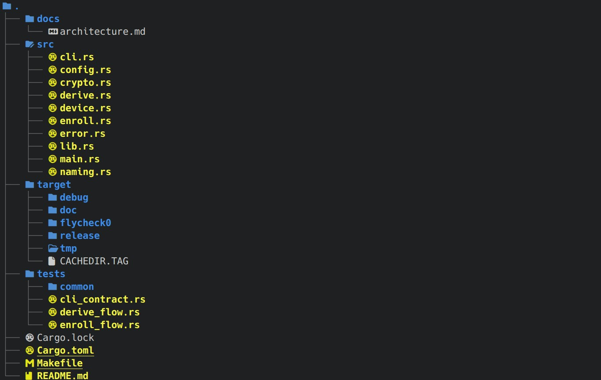
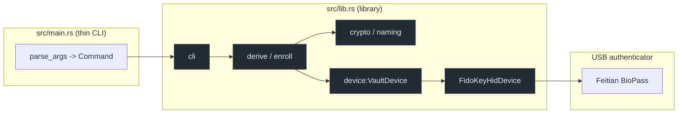

# 🔐 KevOps Feitian UFA Wrapper

> 🧰 Derive a deterministic **256-bit AES vault key** from a **Feitian BioPass FIDO2** fingerprint
> authenticator using the CTAP2 **hmac-secret** extension — no vault secret is ever stored on disk.

[](https://www.rust-lang.org)
[](https://doc.rust-lang.org/edition-guide/)
[](https://crates.io/crates/ctap-hid-fido2)

---
- [🔐 KevOps Feitian UFA Wrapper](#-kevops-feitian-ufa-wrapper)
  - [Project Structure Tree](#project-structure-tree)
  - [🧭 Overview](#-overview)
  - [🧩 Architecture](#-architecture)
    - [📈 Key-derivation data flow](#-key-derivation-data-flow)
  - [✅ Prerequisites](#-prerequisites)
    - [🦶 udev rule (required on Linux)](#-udev-rule-required-on-linux)
  - [🚀 Quickstart](#-quickstart)
  - [🏗️ DevOps Principles \& Best Practices](#️-devops-principles--best-practices)
    - [🎯 Core principles applied](#-core-principles-applied)
    - [🧪 Quality gates](#-quality-gates)
    - [🔁 CI pipeline](#-ci-pipeline)
    - [🔖 Release \& versioning](#-release--versioning)
  - [🧬 Testing](#-testing)
  - [🔐 Security Model](#-security-model)
  - [📊 Observability](#-observability)
  - [🧯 Troubleshooting](#-troubleshooting)
  - [🗺️ Known Limitations \& Roadmap](#️-known-limitations--roadmap)
  - [📚 References](#-references)

## Project Structure Tree

```bash
eza --tree --level=2 --git-ignore --icons=always --group-directories-first
```


## 🧭 Overview

The wrapper asks a Feitian BioPass USB authenticator to compute
`HMAC-SHA-256(CredRandom, salt)`, where `CredRandom` is a secret that **never leaves the secure
element**. The 32-byte output is then hashed once more with SHA-256 to produce a fixed-length key
suitable for AES-256.

```
┌──────────────────┐   CTAP2 / USB HID    ┌───────────────────────┐
│  kevops wrapper  │ ───────────────────► │  Feitian BioPass      │
│  (Rust binary)   │ ◄─────────────────── │  (secure element)     │
└──────────────────┘   hmac-secret output └───────────────────────┘
        │                                            │
        │  salt (32B, SHA-256 of label)              │  👆 fingerprint = user verification
        ▼                                            ▼
   SHA-256(output) ──────────►  32-byte AES-256 vault key
```

| 🔑 Property | Value |
|---|---|
| 🚪 Relying Party ID | `bitwarden-alternative.kevops` |
| 🧂 Salt label | `kevops-vault-encryption-salt-xyz` |
| 🔌 Device | Feitian BioPass `vid 0x096e / pid 0x085d` (fallback All-in-Pass `0x0866`) |
| 🛡️ Verification | On-device UV (`uv = Some(true)`) — the fingerprint |
| 📏 Key size | 32 bytes (AES-256), printed as lowercase hex |

---

## 🧩 Architecture

A thin binary plus a library, split so every hardware-free rule is testable.
`FidoKeyHidDevice` is the only module that imports `ctap-hid-fido2`: `derive`
and `enroll` depend on the `VaultDevice` trait, so the test suite runs them
against a recording fake with no BioPass attached.

| 📁 Module | Responsibility |
|---|---|
| `src/config.rs` | RP id, salt label, user handles, credential-name prefix |
| `src/error.rs` | `VaultError` with user-facing messages + exit codes |
| `src/cli.rs` | `Command` / `parse_args` — `enroll`, `derive`, `--pin`, `--help` |
| `src/device.rs` | `VaultDevice` trait + `FidoKeyHidDevice` transport |
| `src/crypto.rs` | `derive_vault_key`, `to_hex` (pure, doctested) |
| `src/naming.rs` | `next_credential_name` — sequential `wrapperNN` labels |
| `src/derive.rs` | key derivation flow |
| `src/enroll.rs` | enrolment flow (R/A, replace, rename) |
| `src/main.rs` | argument handling and presentation only |

The full data-flow diagrams and the credential-management command surface live in
[`docs/architecture.md`](docs/architecture.md):

- [Derive flow](docs/architecture.md#2-derive-flow) — `hmac_secret → SHA-256 → stdout`.
- [Enrolment flow](docs/architecture.md#3-enrolment-flow-r-a-replace-rename-delete) — R/A, the ordering invariant, and why deletes come last.
- [Stream discipline](docs/architecture.md#6-stream-discipline-why-stdout-is-exactly-64-chars) — the "stdout = 64 chars only" guarantee and its test.




> `.github/workflows/ci.yml` is **not** committed yet — it is shown as a
> starting point in "CI pipeline" to mirror `make ci`.

### 📈 Key-derivation data flow

```text
user: cargo run --release [--pin <pin>]

 parse_args ──► Command::Derive { pin }
        │
        ▼ open_device()                                   (USB HID / ctap-hid-fido2)
        │ FidoKeyHidDevice                                  0x096e:085d / 0x0866
        ▼
 eprintln("⚡ tap the sensor ...")            ──► stderr
        │
        ▼ derive_vault_key(device, SALT_LABEL, pin)
        │   device.hmac_secret(salt, pin)      uv=true (fingerprint),
        │                                       or pinUvAuth when --pin is given
        ▼
 crypto::derive_vault_key -> [u8; 32]         SHA-256(hmac_secret) -> AES-256 key
        │ eprintln("🔓 Fingerprint verified ...") ──► stderr
        ▼
 print!("{:x}", key)                                ──► stdout: 64 hex chars ONLY
```

`stdout` is the key channel and **nothing else** is ever written to it — every
user-facing message goes to `stderr`, so `Command::output()` / piping yields a
clean, trimmable token.

---

## ✅ Prerequisites

| 📦 Requirement | Notes |
|---|---|
| 🦀 Rust **1.85+** | The crate uses `edition = "2024"` |
| 🔧 Build deps | `hidapi` needs `libudev` + `pkg-config` |
| 🔌 Hardware | Feitian BioPass (USB) with **at least one fingerprint enrolled** |
| 🔐 udev access | Non-root users need a hidraw rule (see below) |

```bash
# 🐧 Debian / Ubuntu build dependencies
sudo apt-get install -y pkg-config libudev-dev
```

### 🦶 udev rule (required on Linux)

Without this the process fails with `Failed to open device.`:

```bash
sudo tee /etc/udev/rules.d/70-feitian-biopass.rules > /dev/null <<'EOF'
# Feitian BioPass / All-in-Pass FIDO2
SUBSYSTEM=="hidraw", ATTRS{idVendor}=="096e", ATTRS{idProduct}=="085d", MODE="0660", GROUP="plugdev", TAG+="uaccess"
SUBSYSTEM=="hidraw", ATTRS{idVendor}=="096e", ATTRS{idProduct}=="0866", MODE="0660", GROUP="plugdev", TAG+="uaccess"
EOF

sudo udevadm control --reload-rules && sudo udevadm trigger
sudo usermod -aG plugdev "$USER"   # re-login for group change to apply
```

---

## 🚀 Quickstart

```bash
git clone https://github.com/keverall/kevops-feitian-ufa-wrapper.git
cd kevops-feitian-ufa-wrapper

cargo check            # 🧪 fast feedback
cargo build --release  # 📦 optimized artifact

cargo run --release                          # 👆 prompts for the fingerprint
cargo run --release -- enroll                 # 🪪 prompts securely for the device PIN
cargo run --release -- enroll --pin 123456   # 🪪 non-interactive compatibility form

make ci        # 🧰 full offline gate: fmt + toml-lint + clippy + test + doc
```

Expected output — the 64-char key on **stdout**, every human message on **stderr**:

```console
$ cargo run --release 2>/dev/null
4f1c...c07d                      # ← stdout only: 64 hex chars, safe to pipe
$ cargo run --release
⚡ Please tap the Feitian BioPass fingerprint sensor...   # stderr
🔓 Fingerprint verified! 256-bit Vault key derived.       # stderr
```

> ⚠️ **Keep `Cargo.lock` committed** — this is a binary crate, so the lockfile is what makes builds
> reproducible across dev, CI, and release.
>
> 🔐 **stdout is a key channel, not a console.** Never add a `println!` to the derive path — the test
> suite asserts stdout stays empty unless the derived key is written.

---

### Commands

| Command | Description |
|---|---|
| `cargo run --release` | Derive the deterministic 256-bit vault key; prompts for fingerprint verification and writes exactly 64 hex characters to stdout. |
| `cargo run --release -- derive [--pin <pin>]` | Explicit derive form; optionally uses PIN authorization when the authenticator requires it. |
| `cargo run --release -- enroll` | Securely prompts for the device PIN, then enrolls a new credential and interactively chooses whether to add or replace project-owned credentials. |
| `cargo run --release -- enroll --pin <pin>` | Non-interactive enrollment form for automation; the PIN remains visible to shell history/process listings. |
| `cargo run --release -- list` | Securely prompts for the PIN and lists resident credentials for the project RP without modifying the authenticator. |
| `cargo run --release -- delete` | Securely prompts for the PIN, shows project-owned credentials, and deletes them only after typing `YES`. |
| `cargo run --release -- --help` / `-h` / `help` | Print command and option usage. |

## 🏗️ DevOps Principles & Best Practices

### 🎯 Core principles applied

| | Principle | How this repo honours it |
|---|---|---|
| 🔁 | **Automate everything** | Every step is a single `make` target; no manual key handling or copy-paste steps |
| 🏗️ | **Everything as code** | Build, lint, and release config live in the repo, versioned with the source |
| 📦 | **Immutable, reproducible artifacts** | `Cargo.lock` committed; `--release` builds are treated as immutable |
| 🧪 | **Shift-left testing** | 50 hardware-free tests in `make test`; `cargo fmt --check`, `taplo`, `clippy -D warnings` and `rustdoc` are all gates |
| 🔒 | **Security by default / least privilege** | Runs unprivileged; scoped udev rule only for the Feitian VID/PID |
| 🚫 | **Zero secrets at rest** | No vault key, PIN, or credential material is persisted anywhere on disk |
| 🔗 | **Supply-chain integrity** | Pinned dependency versions, committed lockfile, `cargo audit` in CI |
| 📊 | **Observability** | Structured CTAP/HID tracing via `Cfg` + keep-alive prompts routed to stderr |
| 🧯 | **Fail fast, fail loud** | Explicit errors for missing device / missing hmac-secret output |
| ♻️ | **Idempotent & stateless** | The binary holds no state; re-running yields the same key for the same device+salt |
| 📝 | **Docs as code** | This README changes in the same PR as the behaviour it documents |

### 🧪 Quality gates

Everything is a single Makefile target, so local runs and CI cannot drift:

```bash
make ci            # 🎯 fmt-check + toml-lint + clippy -D warnings + test + doc
make test          # 🔬 unit, functional and doc tests
make fmt-check     # 🎨 cargo fmt --check + taplo fmt --check
make lint-rust     # 🧹 cargo clippy --all-targets -- -D warnings
make toml-lint     # 🧾 taplo lint (schema-aware TOML)
make audit         # 🔗 cargo audit --deny warnings
make doc           # 📚 rustdoc, warnings denied
make run           # 👆 derive the key
make enroll        # 🪪 enrol/replace the credential
make help          # 📋 list all targets
```

`taplo` and `cargo-audit` are optional: when they are not installed the target
**skips with an install hint** (exit 0), and `make STRICT=1 ci` turns a missing
tool into a hard failure — the form to use in CI.

```bash
sudo apt-get install -y pkg-config libudev-dev
cargo install taplo-cli --locked cargo-audit --locked   # 🔒 unlocks the TOML + supply-chain gates
```

### 🔁 CI pipeline

```yaml
# .github/workflows/ci.yml — mirrors `make ci` exactly
name: ci
on: [push, pull_request]
jobs:
  quality:
    runs-on: ubuntu-latest
    steps:
      - uses: actions/checkout@v4
      - run: sudo apt-get install -y pkg-config libudev-dev   # 🔧 hidapi
      - run: cargo install taplo-cli --locked                 # 🧾 TOML gate
      - run: make STRICT=1 ci                                 # 🎯 cannot skip a gate
      - uses: rustsec/audit-check@v2                          # 🔗 supply chain
        with: { token: "${{ secrets.GITHUB_TOKEN }}" }}
```

> 🤖 Hardware-in-the-loop (real BioPass) cannot run on hosted runners — keep the device-dependent
> path behind a self-hosted runner or a manual smoke-test job. The functional suite is
> hardware-free by design, so CI still covers every decision the flows make.

### 🔖 Release & versioning

- 🏷️ **Semantic versioning** driven by `Cargo.toml`.
- 🌿 **Trunk-based**: short-lived branches, PR required, green CI before merge.
- 🧾 **Tagged releases** build once and publish the artifact — never rebuild per environment.
- 🔐 **Supply chain**: review `cargo audit` output before every release; bump `ctap-hid-fido2`
  deliberately (its API changed between minor versions — see Troubleshooting).

---

## 🧬 Testing

50 tests, all hardware-free: `tests/common/mod.rs` provides `FakeDevice`, a
`VaultDevice` that records calls **in order** (`Create`, `Rename`, `Delete`), so
the suite can assert the safety properties of the flows rather than just their
happy path:

| ✅ Property under test | Assertion |
|---|---|
| Replace never strands the vault | `Create` → `Rename` → `Delete` — old credentials die **after** the new one is named |
| A rename failure stops before any delete | no `Delete` is ever recorded |
| Sequential naming | `01` → `02` → `03`, `07` → `08`, `99` → `100`, foreign names fall back to `01` |
| Interactive R/A | `Ask` delegates to the policy; anything but `R` adds |
| stdout is a pure key channel | 0 bytes on stdout when the device fails; prompts on stderr |
| Key derivation | matches an independent SHA-256; deterministic; 64 hex chars |

Only a short list is shown — run `make test` for the full set.

---

## 🔐 Security Model

| 🛡️ Control | Detail |
|---|---|
| 🔏 Key custody | `CredRandom` never leaves the secure element; only its HMAC output is returned |
| 👆 User verification | `uv = Some(true)` forces the fingerprint — the key cannot be derived from a stale token |
| 🔐 PIN (`uv = None`) | If the authenticator answers `CTAP2_ERR_PIN_REQUIRED` for the hmac-secret extension, pass `derive --pin <pin>`. This authenticates with `pinUvAuth`, which sets `uv = None`, **bypassing the fingerprint** — a deliberate trade-off, so prefer the hardware credential's built-in UV where the device allows it |
| 🧂 Domain separation | A distinct 32-byte salt per vault database; changing the salt yields a different key |
| 🚫 No persistence | Nothing is written to disk; the key goes to stdout for the caller to consume |
| 🔑 No fallback secrets | There is no password or recovery file that bypasses the hardware |

> ⚠️ **stdout is not a secret channel.** When wiring this into a vault, capture stdout directly
> (pipe or `Command::output()`), avoid shell history and shared terminals, and never redirect the
> key to a file or a log.

---

## 📊 Observability

```rust
// Wired up once, in `src/device.rs::open_device()`
let mut cfg = Cfg::init();
cfg.enable_keep_alive_msg = true;       // 📣 keep the touch prompt
cfg.keep_alive_msg_to_stderr = true;   // 📣 ...on stderr: stdout carries the key only
cfg.enable_log = true;                 // 🕵️ verbose CTAP/HID hex tracing (debug only)
```

- 🕵️ `enable_log` — full CTAP frame tracing while debugging device issues.
- 📣 `keep_alive_msg` — user-facing "touch the sensor" prompt; route to **stderr** when stdout is
  consumed as the key channel (recommended for automation).

---

## 🧯 Troubleshooting

| 🚨 Symptom | ✅ Fix |
|---|---|
| `Failed to open device.` | 🔌 Check `lsusb` for `096e:085d`; install the udev rule; re-login for `plugdev`; confirm the device is not claimed by another process (`pcscd`, browser WebAuthn) |
| `unresolved import fidokeyhid` / `no method get_hmac_secret` | 📦 Those APIs do not exist in `ctap-hid-fido2` 3.6.0 — use `GetAssertionArgsBuilder` + `AssertionExtension::HmacSecret` |
| Salt rejected / panic on unwrap | 🧂 The salt must be exactly **32 bytes**; use `create_hmac_secret_from_string` |
| `no assertion returned` | 🪪 No credential registered for the RP ID — enroll with `CredentialExtension::HmacSecret(Some(true))` first |
| No hmac-secret output, finger accepted | 🔑 Many authenticators require a `pinUvAuthToken`; supply a PIN via `derive --pin <pin>` (note: this sets `uv = None`) |
| `response_status err = 0x36 CTAP2_ERR_PIN_REQUIRED` | 🔐 This BioPass requires `pinUvAuth` for the hmac-secret extension: re-run with `--pin <pin>` (this is what `src/device.rs::hmac_secret` forwards) |
| Build fails on the `missing_docs` lint | 📝 Public API must be documented; add a `///` doc comment to the item (the README's "docs as code" gate) |
| Permission denied opening hidraw | 🦶 Re-apply the udev rule and verify `groups` includes `plugdev` |
| Fingerprint never triggers | 👆 Ensure a fingerprint is enrolled and the device is not in U2F-only mode |

---

## 🗺️ Known Limitations & Roadmap

- 🔐 **PIN trade-off on `derive`** — where the device demands `pinUvAuth`, supplying `--pin`
  bypasses the fingerprint (`uv = None`). Prefer a credential that authenticates with UV.
- 🧪 **Hardware path not CI-tested** — the functional suite runs against `FakeDevice`; a real
  `enroll`/`derive` round trip still needs a self-hosted runner or a manual smoke test.
- 🧩 **Single device model** — only `096e:085d` / `096e:0866` are probed; consider `HidParam::get()`
  plus a first-match prompt for broader device support.
- 🗑️ **No un-enrol command** — `enroll` can replace, but there is no standalone `unenrol`
  subcommand yet.

---

## 📚 References

- 📘 [CTAP 2.1 — HMAC Secret Extension (§12.5)](https://fidoalliance.org/specs/fido-v2.1-ps-20210615/fido-client-to-authenticator-protocol-v2.1-ps-20210615.html#sctn-hmac-secret-extension)
- 📦 [ctap-hid-fido2 crate](https://crates.io/crates/ctap-hid-fido2)
- 🦀 [Rust Edition 2024](https://doc.rust-lang.org/edition-guide/rust-2024/index.html)
- 🔐 [FIDO2 / WebAuthn spec](https://www.w3.org/TR/webauthn-3/)

---

<sub>🤖 Built with a DevOps-first mindset: reproducible builds, least privilege, zero secrets at rest.</sub>
